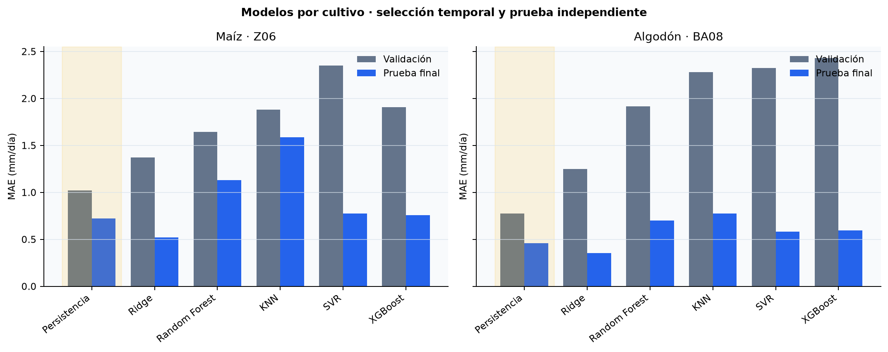

# Evaluación predictiva adicional: maíz y algodón (2025)

Este experimento amplía el apartado 4.3 del TFM. Entrena y evalúa, **por separado**, los seis enfoques ya definidos para el piloto de pimiento en dos combinaciones adicionales de cultivo y estación. No constituye todavía un modelo único transferible entre cultivos ni una validación en campo.

## Datos y control de calidad

| Caso | Fuente | Periodo | Filas diarias | Completas | Necesidad cero | Kc distintos |
| --- | --- | --- | ---: | ---: | ---: | ---: |
| Maíz · Z06 Ejea de los Caballeros, Zaragoza | `data/external/siar_necesidades_maiz_Z06_2025.csv` | 01/04–30/09/2025 | 183 | 183 | 14 | 6 |
| Algodón · BA08 Don Benito, Badajoz | `data/external/siar_necesidades_algodon_BA08_2025.csv` | 01/04–30/09/2025 | 183 | 183 | 8 | 5 |

Son descargas CSV del cálculo de necesidades netas de [SiAR](https://servicio.mapa.gob.es/siarweb/necesidadesHidricas/calculo), con metadatos de procedencia junto a cada fichero. El código verifica fechas, ausencias, valores no negativos y coherencia `necesidad neta ≈ max(ETc − Pe, 0)` con tolerancia de 0,01 mm por redondeo. Los CSV originales no se modifican. La etiqueta es **necesidad neta calculada por SiAR**; no representa volumen efectivamente aplicado ni ahorro real.

## Protocolo

Se reutiliza `src/models/train_evaluate.py`, con el mismo objetivo y los mismos nueve predictores que en pimiento: Kc, seno/coseno del día del año y retardos/sumas de la necesidad neta de días anteriores. No se introducen ET0, ETc, Pe ni necesidad neta del propio día entre los predictores, porque darían información no disponible en el instante de predicción o fuga de la fórmula de la etiqueta. Las variables históricas se generan en un calendario diario completo, siempre desplazadas al menos un día.

Cada caso tiene 155 días de desarrollo (01/04–02/09) y 28 días finales de prueba (03/09–30/09). En el desarrollo se hacen tres cortes cronológicos con ventana de entrenamiento expansiva. Se selecciona el modelo con menor MAE medio de validación y solo después se mide en el tramo final reservado. Se comparan persistencia de un día, Ridge, Random Forest, KNN, SVR y XGBoost; las configuraciones y la semilla fija son las mismas del piloto. La persistencia en prueba utiliza la referencia **ya conocida del día anterior**: es una evaluación rodante a un día, no una predicción recursiva de 28 días.

## Resultados

| Caso | Modelo | MAE medio validación (mm/día) | MAE prueba (mm/día) |
| --- | --- | ---: | ---: |
| Maíz Z06 | Persistencia **(seleccionado)** | **1,022** | 0,725 |
| Maíz Z06 | Ridge (mejor candidato ML) | 1,371 | **0,519** |
| Maíz Z06 | Random Forest | 1,646 | 1,133 |
| Maíz Z06 | KNN | 1,879 | 1,588 |
| Maíz Z06 | SVR | 2,349 | 0,778 |
| Maíz Z06 | XGBoost | 1,909 | 0,757 |
| Algodón BA08 | Persistencia **(seleccionado)** | **0,776** | 0,458 |
| Algodón BA08 | Ridge (mejor candidato ML) | 1,250 | **0,355** |
| Algodón BA08 | Random Forest | 1,918 | 0,703 |
| Algodón BA08 | KNN | 2,279 | 0,776 |
| Algodón BA08 | SVR | 2,323 | 0,580 |
| Algodón BA08 | XGBoost | 2,430 | 0,596 |

En ambos casos Ridge supera a la persistencia en **esta prueba final concreta**, pero la persistencia obtuvo el menor **MAE medio de los tres cortes** de validación y se mantiene como decisión elegida antes de mirar la prueba. No ganó necesariamente en cada corte individual. Elegir Ridge a posteriori por estos 28 días introduciría sesgo de selección. Como referencia, el experimento original de pimiento AL01 eligió también persistencia (MAE de validación 0,434; MAE de prueba 0,120 mm/día, 148 etiquetas). Las magnitudes entre cultivos no miden transferibilidad: son series, estaciones, ciclos y tramos finales diferentes, y pimiento procede de la tabla analítica original del 4.2.



## Reproducción y límites

Desde la raíz del repositorio, con las dependencias instaladas:

```powershell
python -m src.models.evaluate_crop_cases
python -m unittest tests.test_evaluate_crop_cases -v
```

El script genera el informe íntegro en [`model_evaluation_multicultivo_2025.json`](data_samples/model_evaluation_multicultivo_2025.json), las predicciones diarias y errores de los seis enfoques en [`model_predictions_multicultivo_2025.csv`](data_samples/model_predictions_multicultivo_2025.csv), la figura comparativa anterior y las figuras de predicción de [maíz](images/model_predictions_maiz_Z06_2025.png) y [algodón](images/model_predictions_algodon_BA08_2025.png). El informe incluye los tres cortes, MAE, RMSE, R², sesgo y error semanal de validación/prueba. No requiere token de SiAR ni AEMET porque utiliza las dos instantáneas públicas versionadas; tampoco altera el informe original de pimiento.

La ampliación añade diversidad de cultivos y estaciones, pero cada evaluación sigue disponiendo de **una sola campaña**. No demuestra generalización a otro año, otra finca, otro sistema de cultivo o condiciones meteorológicas nuevas. Los 28 días de prueba coinciden con el final de campaña; el bajo error allí no garantiza el mismo comportamiento en fases de crecimiento ni en episodios de lluvia. Antes de usar el sistema para recomendaciones operativas harían falta más campañas, contraste con riego aplicado, humedad del suelo, respuesta del cultivo y evaluación agronómica independiente.
