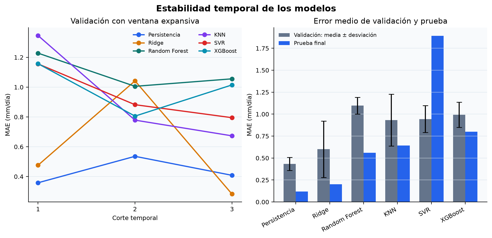
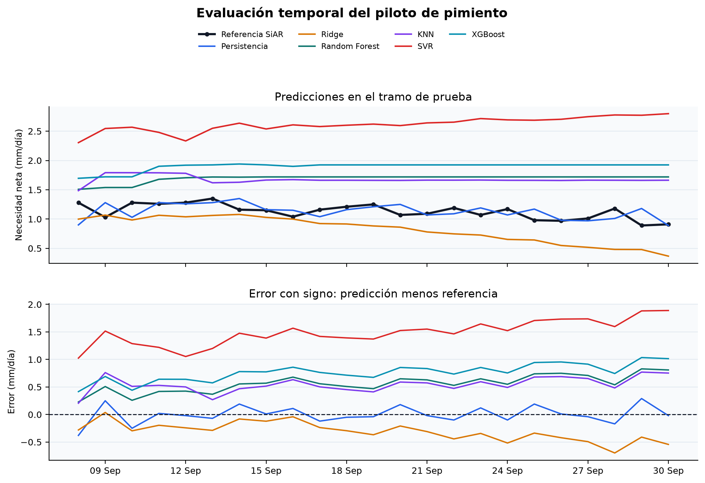
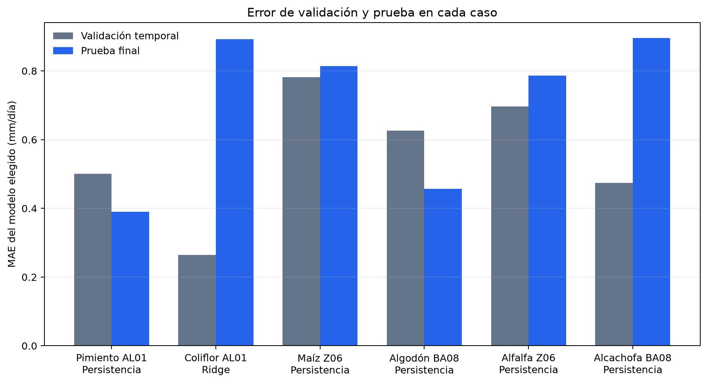
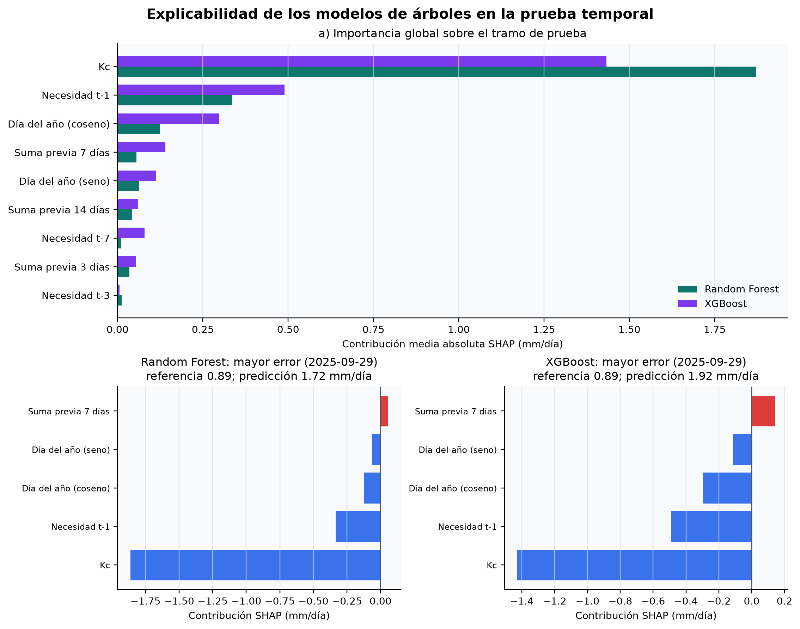

# 4.3. Desarrollo y evaluación del modelo predictivo

El objetivo de esta fase es comprobar si un modelo puede anticipar la necesidad
neta diaria de riego publicada por SiAR para el piloto de pimiento en la
estación `AL01` La Mojonera. La variable objetivo,
`target_net_irrigation_need_mm`, es una referencia agronómica calculada y no una
medición del riego aplicado ni de la respuesta real del cultivo. Por ello, el
experimento demuestra la viabilidad del flujo de modelización del DSS, pero no
permite afirmar todavía que se optimice el consumo de agua.

## 4.3.1. Conjunto de modelización y prevención de fuga de información

El entrenamiento consume directamente la tabla analítica construida en el
apartado 4.2 (`data/processed/modeling_dataset_daily.csv`). Así se mantiene la
trazabilidad entre extracción, preparación y modelización, y se evita repetir
transformaciones con criterios diferentes. De los 150 días del ciclo, 148
disponen de objetivo válido y participan en el experimento.

De las 88 columnas de la tabla analítica no se introducen todas en los modelos:
incluyen identificadores, campos de control, variables derivadas de la propia
etiqueta y meteorología del día que no estaría disponible al emitir una
predicción. Los quince predictores utilizados son el coeficiente de cultivo conocido para
la fecha; la codificación cíclica del día del año; los retardos de 1, 3 y 7 días
de la necesidad neta y de la ET0; los acumulados históricos de necesidad de
3, 7 y 14 días; y las medias previas de ET0 en esas mismas ventanas. Todos
ellos están disponibles antes del día que se desea estimar. Los retardos se
calculan por fecha de calendario: si falta el día anterior, el retardo de un
día queda ausente y no se sustituye por la última fila disponible.

Se excluyen expresamente la ET0, la ETc y la precipitación efectiva del mismo
día, así como las variables diagnósticas derivadas de ellas. La referencia SiAR
se aproxima mediante `max(ET0 × Kc − Pe, 0)`; incluir esos campos permitiría
reconstruir el objetivo de forma algebraica y produciría métricas aparentemente
buenas sin capacidad predictiva real. Los valores ausentes restantes se imputan
con la mediana aprendida exclusivamente en cada periodo de entrenamiento.
La incorporación de ET0 retardada corrige una asimetría de la comparación
inicial: los algoritmos disponen ahora del mismo tipo de memoria meteorológica
reciente que utiliza la vía física, pero nunca de la ET0 del día objetivo.

## 4.3.2. Diseño de validación temporal

La evaluación mantiene el orden cronológico. Los últimos 23 registros, del 8
al 30 de septiembre de 2025, se reservan como prueba final y no intervienen en
la selección. Las 125 observaciones anteriores forman el periodo de desarrollo.
Sobre este periodo se aplica una validación temporal con tres cortes y ventana
expansiva: cada modelo aprende únicamente con el pasado y se valida sobre el
bloque inmediatamente posterior. Los tamaños de entrenamiento y validación
son, respectivamente, 32/31, 63/31 y 94/31 observaciones; los tres bloques de
validación cubren del 2 de junio al 7 de septiembre. Estos cortes reproducen
consultas a un día con nuevas observaciones que se van conociendo, no una
predicción de siete días sin actualizar entradas.

Este diseño es más robusto que escoger un modelo mediante una sola partición,
porque permite observar si su rendimiento se mantiene a medida que avanza el
ciclo del cultivo. El bloque de prueba se consultó después de seleccionar el
enfoque con menor MAE medio de validación para esta comparación de seis modelos.
El capítulo 5 emplea posteriormente las mismas fechas para evaluar otro método,
por lo que ese tramo no constituye una segunda prueba independiente de todo el
proyecto. Se fija la semilla 42 y las predicciones se limitan a un mínimo físico
de 0 mm/día.

## 4.3.3. Enfoques comparados

Se comparan seis alternativas con distinta complejidad. Los tres enfoques
iniciales se conservan y se añaden KNN, SVR y XGBoost para ampliar la evidencia
antes de elegir el modelo:

1. **Persistencia:** para una predicción a un día, asigna al día `t` la
   necesidad observada en `t-1`. Si el retardo no está disponible, utiliza la
   mediana aprendida en el periodo de entrenamiento. No es un algoritmo de
   aprendizaje automático, sino un baseline temporal que los modelos más
   complejos deben superar.
2. **Regresión Ridge:** modelo lineal regularizado, precedido por imputación y
   estandarización. Aporta una referencia interpretable y reduce el riesgo de
   sobreajuste.
3. **Random Forest:** conjunto de 300 árboles, con profundidad máxima de cinco
   niveles y un mínimo de cuatro muestras por hoja. Representa relaciones no
   lineales con una configuración conservadora para el tamaño muestral.
4. **KNN Regressor:** estima cada día a partir de los siete vecinos más cercanos,
   ponderados por distancia. Incluye imputación y estandarización porque las
   distancias son sensibles a la escala de las variables.
5. **Support Vector Regression:** utiliza un kernel RBF para representar
   relaciones no lineales. Se configura con `C=10` y `epsilon=0,1`, precedido
   por imputación y estandarización.
6. **XGBoost Regressor:** aplica *gradient boosting* sobre 250 árboles poco
   profundos, con tasa de aprendizaje de 0,03, submuestreo y regularización.
   La configuración es deliberadamente conservadora para reducir el riesgo de
   sobreajuste en una muestra pequeña.

No se buscan hiperparámetros sobre el tramo de prueba. Todos los modelos se
comparan con configuraciones fijadas, la misma matriz de predictores y los
mismos cortes temporales. La persistencia participa en el mismo procedimiento
de selección, evitando desplegar un algoritmo más complejo si no aporta una
mejora estable y medible.

## 4.3.4. Métricas de evaluación

El MAE diario es la métrica principal porque se interpreta directamente en
milímetros y es menos sensible que el RMSE a episodios extremos. Se añaden el
RMSE diario, el coeficiente R², el sesgo medio —positivo cuando se sobreestima y
negativo cuando se infraestima— y el MAE de los acumulados semanales. En este
apartado cada bloque semanal empieza en la primera fecha del corte evaluado y
agrupa hasta siete días consecutivos de calendario; se comparan las sumas de
referencia y predicción de esos bloques, incluido el último si es parcial.
No equivale a las semanas naturales completas de lunes a domingo del apartado
5.3.5. Esta última métrica es coherente con el DSS, que debe ofrecer recomendaciones
diarias y semanales. El R² se interpreta con cautela: el tramo final presenta
una variación reducida de la necesidad neta y puede producir valores negativos
aunque el error absoluto sea pequeño. Por ello no se utiliza para seleccionar
el modelo.

## 4.3.5. Resultados de validación

**Tabla 4.13. Rendimiento medio en los tres cortes de validación temporal.**

| Enfoque | MAE diario (media ± desv.) | RMSE diario | Sesgo diario | MAE semanal |
|---|---:|---:|---:|---:|
| Persistencia | **0,434 ± 0,075** | **0,644** | **0,013** | **0,926** |
| Ridge | 0,600 ± 0,322 | 0,743 | 0,369 | 2,886 |
| Random Forest | 1,096 ± 0,095 | 1,372 | -0,422 | 6,268 |
| KNN | 0,933 ± 0,295 | 1,073 | -0,488 | 5,384 |
| SVR | 0,944 ± 0,154 | 1,160 | -0,614 | 5,228 |
| XGBoost | 0,993 ± 0,144 | 1,289 | -0,324 | 5,591 |

La persistencia obtiene el menor MAE medio. Ridge sigue siendo el candidato de
aprendizaje automático más competitivo, pero presenta mayor variabilidad entre
cortes. KNN queda en una posición intermedia, mientras que Random Forest, SVR
y XGBoost no compensan su mayor complejidad. Ningún
algoritmo de aprendizaje supera de forma estable a la persistencia en los tres
cortes incluso después de incorporar ET0 histórica retardada. La Figura 4.6 hace visible esta inestabilidad y justifica seleccionar
el baseline antes de consultar la prueba final.

## 4.3.6. Evaluación sobre el tramo de prueba

**Tabla 4.14. Resultados sobre el periodo de prueba reservado.**

| Enfoque | MAE diario | RMSE diario | R² | Sesgo diario | MAE semanal |
|---|---:|---:|---:|---:|---:|
| Persistencia | **0,120** | **0,156** | -0,561 | **-0,000** | **0,172** |
| Ridge | 0,201 | 0,237 | -2,602 | -0,097 | 0,775 |
| Random Forest | 0,560 | 0,577 | -20,311 | 0,560 | 3,219 |
| KNN | 0,642 | 0,671 | -27,840 | 0,642 | 3,692 |
| SVR | 1,890 | 1,928 | -237,156 | 1,890 | 10,870 |
| XGBoost | 0,800 | 0,814 | -41,423 | 0,800 | 4,598 |

La persistencia sigue de cerca la referencia SiAR y no presenta sesgo
apreciable. Ridge conserva el segundo mejor resultado y reduce su error al
disponer de la ET0 reciente, aunque todavía tiende a infraestimar
conforme avanza septiembre. KNN, Random Forest, SVR y XGBoost sobreestiman el
tramo final. El R² negativo de la persistencia no contradice su MAE de 0,120
mm/día: durante la prueba la referencia se concentra en un intervalo estrecho,
aproximadamente entre 0,89 y 1,35 mm/día, por lo que el denominador del R² es
pequeño. La Figura 4.7 muestra las predicciones y el error con signo de los seis
enfoques.

El bootstrap pareado por bloques temporales de siete días (Künsch, 1989), con 5.000
remuestreos y semilla 42, confirma que ninguno de los modelos de aprendizaje
mejora a la persistencia en este tramo. La diferencia
`MAE(persistencia) - MAE(modelo)` es de -0,081 mm/día para Ridge, con IC 95 %
[-0,135; -0,038]. Para Random Forest, KNN, SVR y XGBoost las diferencias son,
respectivamente, -0,440 [-0,516; -0,349], -0,523 [-0,603; -0,431], -1,771
[-2,011; -1,530] y -0,680 [-0,753; -0,585] mm/día. Todos los intervalos
favorecen a la persistencia dentro de estos 23 días; no demuestran que esa
ventaja se transfiera a otras campañas.

## 4.3.7. Decisión e interpretación

Con la evidencia disponible, la decisión técnica es mantener la persistencia
como referencia predictiva del piloto y no desplegar todavía ninguno de los
cinco algoritmos de aprendizaje. Ridge se conserva como el mejor candidato de
aprendizaje automático para futuras comparaciones. Esto no significa que el
aprendizaje automático carezca de utilidad, sino que la muestra actual —un
único ciclo, cultivo y estación— no contiene información suficiente para
demostrar una mejora estable frente a una serie muy autocorrelacionada.

El tramo de septiembre se reservó antes del ajuste inicial, pero posteriormente
se reutilizó para interpretar los modelos mediante SHAP, comprobar el motor
físico y orientar decisiones operativas de la aplicación. Por ello, sus
resultados son una evaluación retrospectiva reutilizada y no una prueba final
independiente del sistema completo. Esta limitación no altera las métricas,
pero restringe el alcance de las conclusiones.

El buen resultado de la persistencia es coherente con el problema evaluado. El
objetivo cambia gradualmente entre días consecutivos porque el Kc y gran parte
de las condiciones meteorológicas presentan continuidad. Su uso operativo es
de un día vista y supone que, al emitir la recomendación, la necesidad del día
anterior ya está disponible. Para predecir una semana completa sin nuevas
observaciones sería necesario evaluar una estrategia recursiva diferente, en
la que cada predicción alimente el día siguiente.

El resultado también evita confundir dos funciones del DSS. La fórmula SiAR
sigue siendo el baseline agronómico explicable para calcular la necesidad
cuando se conocen las variables meteorológicas del día. La persistencia es el
baseline predictivo para anticiparla con información pasada. Un modelo futuro
deberá superar ambos referentes en el contexto de uso que le corresponda.

## 4.3.8. Limitaciones y evolución prevista

La etiqueta reproduce una referencia calculada y no incorpora humedad del
suelo, condiciones específicas de la parcela, eficiencia de la instalación, riego aplicado,
drenaje, rendimiento ni estrés del cultivo. Además, la meteorología AEMET
disponible no coincide temporalmente con el ciclo usado para entrenar. Por ello,
las métricas no demuestran ahorro de agua ni generalización a otras parcelas.

Antes de reconsiderar el despliegue se deben incorporar varias campañas y
estaciones, alinear datos meteorológicos históricos y pronosticados, y registrar
riego real y sensores de parcela. Una evolución coherente consiste en estimar
primero la ET0 futura con predicciones meteorológicas y, cuando existan
observaciones agronómicas suficientes, aprender una corrección sobre el
baseline físico. La comparación deberá repetirse por campaña y estación,
manteniendo grupos temporales independientes.

## 4.3.9. Reproducibilidad y evidencias

El flujo se implementa en el módulo de entrenamiento y evaluación identificado
en el Anexo A. Su ejecución genera el informe completo de validación y prueba
(`docs/data_samples/model_evaluation_4_3.json`), las predicciones de los seis
enfoques para los 23 días finales
(`docs/data_samples/model_predictions_4_3.csv`), las Figuras 4.6 y 4.7 y el
modelo serializado localmente. Este último se excluye de Git por ser un
artefacto reproducible. Las pruebas automatizadas verifican el orden temporal,
el tratamiento de huecos, la reutilización de variables del 4.2, la exclusión
de variables con fuga, la restricción no negativa y la reproducibilidad.

## 4.3.10. Reentrenamiento con campañas disponibles hasta octubre de 2026

Se amplió el experimento original sin reemplazarlo. Se agruparon los nueve CSV
oficiales disponibles en seis combinaciones de cultivo y estación: pimiento,
coliflor, maíz, algodón, alfalfa y alcachofa. Pimiento, maíz y algodón incluyen
2025 y 2026; los otros tres cultivos solo disponen de una campaña parcial de
2026. El archivo original de cada descarga permanece intacto. En total se
leyeron 1776 filas CSV y se utilizaron 1584 jornadas completas con Kc positivo.
Las fechas incompletas no se convirtieron en ceros y los días fuera del ciclo
quedaron excluidos de las métricas, para evitar un resultado artificialmente
favorable al predecir ausencia de cultivo.

Se mantuvieron la variable objetivo, los quince predictores y los seis enfoques
del apartado 4.3.3. Los retardos se calcularon sobre el calendario antes de
filtrar los días válidos: el primer día de 2026 no hereda el último valor de
2025. Para cada combinación se reservó el 15 % final de las jornadas activas
como prueba; el modelo se seleccionó únicamente por el MAE medio de tres cortes
temporales del periodo anterior. Después de medir la prueba, se reajustó el
enfoque seleccionado con todos los días válidos disponibles y se guardó su
artefacto localmente. Ese último ajuste no tiene una prueba independiente
posterior y no se utiliza en la aplicación Streamlit.

**Tabla 4.15. Reentrenamiento por cultivo y estación con datos hasta el 22 de octubre de 2026.**

| Caso | Jornadas activas válidas | Prueba final | Modelo elegido | MAE validación (mm/día) | MAE prueba (mm/día) |
|---|---:|---:|---|---:|---:|
| Pimiento AL01, 2025–2026 | 300 | 45 | Persistencia | 0,501 | 0,390 |
| Coliflor AL01, 2026 | 147 | 23 | Ridge | 0,313 | 0,904 |
| Maíz Z06, 2025–2026 | 366 | 55 | Persistencia | 0,782 | 0,814 |
| Algodón BA08, 2025–2026 | 365 | 55 | Persistencia | 0,626 | 0,457 |
| Alfalfa Z06, 2026 | 239 | 36 | Persistencia | 0,699 | 0,816 |
| Alcachofa BA08, 2026 | 176 | 27 | Persistencia | 0,504 | 0,779 |

En cinco casos la selección favoreció la persistencia. En coliflor se eligió
Ridge por validación, pero en la prueba obtuvo 0,904 mm/día; la diferencia
entre validación y prueba no acredita una mejora estable. El aumento de error entre
validación y prueba en coliflor y alcachofa advierte de cambios de fase y de la
escasa estabilidad de una única campaña parcial. Tampoco se comparan los MAE
de esta tabla con los de la Tabla 4.14 como si compartieran el mismo tramo de
prueba: tienen periodos y tamaños diferentes.

Este reentrenamiento mejora la cobertura experimental, no demuestra mayor
precisión ni ahorro de agua. La etiqueta sigue siendo la referencia calculada
por SiAR; no se dispone de riego aplicado ni de un histórico de predicciones
AEMET emitidas antes de cada fecha objetivo. La evaluación es rodante a un día
y presupone que la necesidad del día anterior ya se conoce. La dosis mostrada
en Streamlit sigue procediendo del motor agronómico y de reglas, no de estos
modelos serializados.

El experimento se reproduce con el módulo indicado en el Anexo A. Genera
`docs/data_samples/model_retraining_2026.json`,
`docs/data_samples/model_predictions_retraining_2026.csv`, la Figura 4.8 y
seis artefactos locales excluidos de Git en `models/retrained_2026`.

## 4.3.11. Modelo de ETc para la aplicación

La necesidad neta del experimento anterior ya contiene la precipitación
efectiva SiAR; por eso no se utilizó como base para volver a descontar la
lluvia prevista por AEMET. Se entrenó por separado una estimación de **ETc**,
es decir, la demanda del cultivo antes de lluvia, para las mismas seis
combinaciones. Los retardos proceden únicamente de ETc observada antes del
día objetivo. La validación temporal selecciona Persistencia en cinco casos y
Ridge en coliflor. Los resultados, la comparación con el cálculo físico y la
decisión de uso en Streamlit se documentan en
[`INTEGRACION_ETC_AEMET_2026.md`](../tecnica/INTEGRACION_ETC_AEMET_2026.md).

El cálculo físico obtuvo menor MAE en cinco de los seis tramos de prueba. Por
ello, estos modelos directos de ETc se conservan como comparación y no son la
vía predictiva principal. La ampliación multianual descrita en 4.3.13 predice
ET0 por estación, la transforma mediante Kc y la contrasta con media de siete
días antes de intervenir en la dosis. Tras elegir la base, el motor aplica
una sola vez la fracción supuesta de lluvia AEMET y la eficiencia del riego.
Esta decisión operativa utiliza resultados del tramo de prueba y no constituye
una segunda evaluación independiente del sistema desplegado.

## 4.3.12. Explicabilidad de los modelos de árboles

Se aplicó TreeSHAP a Random Forest y XGBoost para analizar su comportamiento
en los mismos 23 días de prueba del piloto original. Los modelos se ajustaron
solo con las 125 observaciones del periodo de desarrollo y no se modificaron la
partición, las variables ni los hiperparámetros del apartado 4.3. Las
contribuciones SHAP explican cómo construye cada modelo su predicción; no
demuestran causalidad ni bastan por sí solas para explicar el error.

**Tabla 4.17. Variables con mayor contribución media absoluta en la prueba temporal.**

| Modelo | Variable | Contribución media absoluta | Porcentaje del total |
|---|---|---:|---:|
| Random Forest | Kc | 1,898 mm/día | 74,0 % |
| Random Forest | Necesidad t-1 | 0,275 mm/día | 10,7 % |
| Random Forest | Día del año (coseno) | 0,111 mm/día | 4,3 % |
| XGBoost | Kc | 1,292 mm/día | 45,2 % |
| XGBoost | Necesidad t-1 | 0,454 mm/día | 15,9 % |
| XGBoost | Día del año (coseno) | 0,252 mm/día | 8,8 % |
| Random Forest | ET0 retardada y medias de ET0 (agregado) | 0,115 mm/día | 4,5 % |
| XGBoost | ET0 retardada y medias de ET0 (agregado) | 0,440 mm/día | 15,4 % |

El resultado debe interpretarse junto con la distribución temporal. El periodo
de desarrollo contiene valores de Kc entre 0,3 y 1,0 y una necesidad media de
4,041 mm/día, mientras que toda la prueba corresponde a Kc igual a 0,3 y su
media desciende a 1,130 mm/día. En ambos modelos, Kc y la necesidad del día
anterior concentran la mayor parte de la contribución. Las seis variables de
ET0 retardada y medias de ET0 suman un 4,5 % de la importancia en Random
Forest y un 15,4 % en XGBoost. Por tanto, su aportación es secundaria en el
primer modelo y apreciable en el segundo, pero no evita que ambos árboles se
ajusten de forma incompleta al tramo final y mantengan un sesgo positivo.

La explicación local del 29 de septiembre, el día de mayor error para ambos
modelos, muestra ese mismo patrón: frente a una referencia SiAR de 0,89 mm/día,
Random Forest estima 1,70 y XGBoost 1,95 mm/día. Este análisis no convierte el
resultado en una relación causal, pero sí permite identificar una dependencia
fuerte del estado fenológico y de los retardos. La persistencia se adapta mejor
al nivel local del tramo final porque utiliza directamente la observación más
reciente. Por tanto, la evidencia XAI refuerza, en lugar de sustituir, la
decisión de no desplegar los árboles con los datos actuales.

El Anexo A recoge el comando y las rutas que regeneran el informe XAI, las
importancias globales, las explicaciones locales y la Figura 4.9.

## 4.3.13. Predicción multianual de ET0 a siete días

Para superar la limitación de una única campaña por cultivo se planteó un
experimento independiente sobre ET0 diaria de estación entre 2021 y 2025. Se
entrenó Ridge para `h=1…9`: aunque la interfaz muestra siete fechas, con dos
días de retraso SiAR hoy requiere `h=2` y el séptimo día `h=8`; si se empieza
mañana se requieren `h=3…9`. Cada horizonte dispone de un artefacto por AL01,
Z06 y BA08. Las medias de 3, 7 y 14 días exigen ventanas completas y todas las
entradas pertenecen a `t` o antes.

La validación con origen rodante prueba 2023, 2024 y 2025 entrenando solo con
años anteriores. Ridge completo obtuvo menor MAE puntual que media 7 días en
las 81 combinaciones estación-año-horizonte. El bootstrap por bloques produjo
63 intervalos que excluyeron cero a favor de Ridge y 18 no concluyentes. En la
ablación frente a Ridge reducido, 74 de 81 intervalos cruzaron cero y cinco
favorecieron al reducido; por tanto, no se atribuye una ganancia estable a las
variables meteorológicas auxiliares.

La persistencia corregida utilizada como segunda referencia parte de la última
ET0 observada y añade el cambio climatológico esperado entre origen y objetivo,
estimado exclusivamente con los años de entrenamiento. Ridge obtuvo 81 de 81
intervalos favorables frente a ella. Frente a media 7 días, los intervalos
favorables / no concluyentes por `h=1…9` fueron 9/0, 6/3, 6/3, 5/4, 5/4, 7/2,
8/1, 8/1 y 9/0. En la ablación completo frente a reducido, solo dos intervalos
favorecieron al completo, 74 cruzaron cero y cinco favorecieron al reducido.
El desglose completo queda versionado en
`docs/data_samples/et0_multiyear_uncertainty_by_horizon.csv`.

En síntesis, el diseño con origen rodante evita mezclar futuro y entrenamiento.
Las tres estaciones, nueve horizontes y 81 ventanas permiten cubrir siete
fechas pese a la latencia SiAR. Frente a media 7 días, 63 intervalos favorecen
a Ridge y 18 son no concluyentes; ninguno favorece la referencia. Frente a
persistencia estacional, los 81 intervalos favorecen a Ridge.

La ablación no demuestra una ganancia estable de las variables auxiliares: 74
intervalos son no concluyentes, dos favorecen al modelo completo y cinco al
reducido. Por ello Ridge se integra de forma controlada, con media 7 días como
respaldo y una puerta prospectiva de 30 casos pareados, ventana móvil máxima de
60 y mejora mínima del 5 %.

La cobertura retrospectiva de 2026 fue aproximadamente 97 % con Ridge en AL01
y BA08. En Z06, SiAR solo devolvió 13 jornadas para enero–octubre y Ridge tuvo
0 % de cobertura tras exigir 14 observaciones completas. El sistema no fabrica
esa serie: usa media 7 días durante un máximo de siete días y después declara
la recomendación no disponible.

Streamlit genera una ET0 distinta para cada fecha, aplica `ET0 × Kc`, descuenta
la lluvia AEMET utilizable y muestra el método y un intervalo residual central
del 80 %. Una tarea diaria emite `h=1…9` sin depender de aperturas de la app,
conserva el primer valor SiAR provisional, detecta revisiones y consolida tras
siete días. Con 30 casos consolidados y pareados, la puerta evalúa como máximo
los 60 más recientes. Ridge se mantiene solo si reduce al menos un 5 % el MAE
de media 7 días; en caso contrario se activa automáticamente el respaldo
físico. El manifiesto fija un reentrenamiento anual tras cerrar y auditar la
campaña. La documentación completa y las 243
comparaciones bootstrap se conservan en
[`SINTESIS_ET0_PARA_MEMORIA.md`](../tecnica/SINTESIS_ET0_PARA_MEMORIA.md) y en
los ficheros de evidencia del repositorio. La batería final de 150 pruebas
incluye la ausencia de fuga temporal, las ventanas completas, los horizontes,
la integridad de los artefactos y la activación del respaldo.
